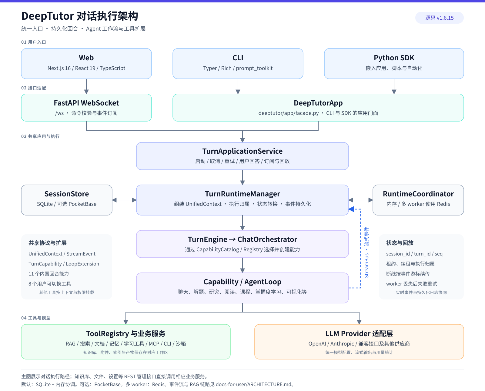
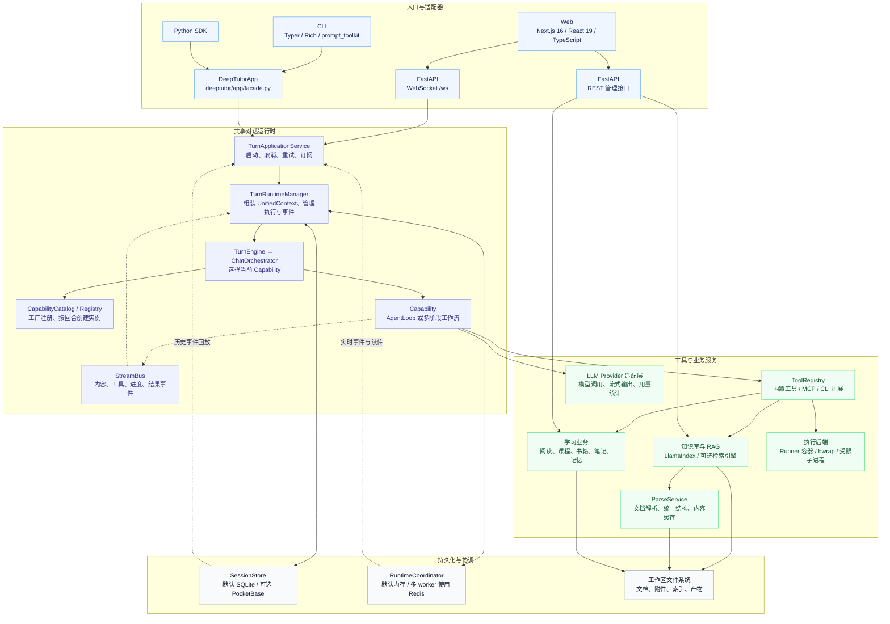
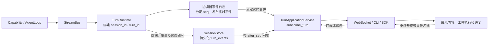
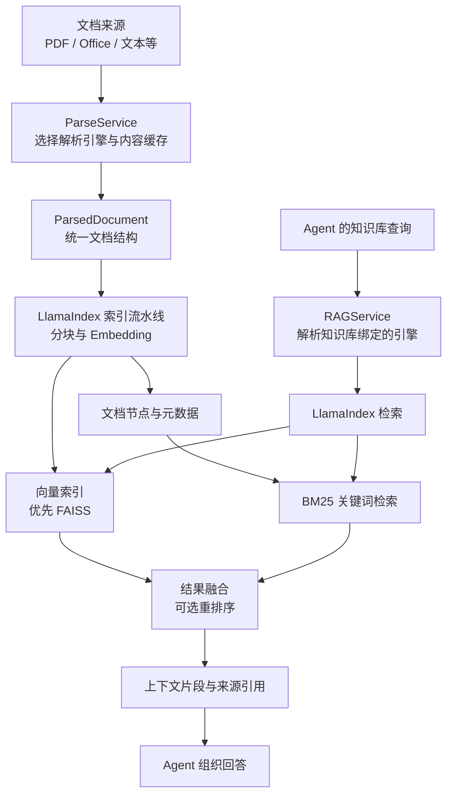

# DeepTutor 架构图

DeepTutor 采用前后端分离的模块化单体架构，以 Agent 工作流为核心。
Web、CLI 和 Python SDK 的对话请求共用应用服务、执行引擎及事件协议；
知识库、文件、设置等管理操作通过独立的 REST 接口调用业务服务。
下图对应源码版本 **1.6.15**。

[直接打开 SVG 总览图](../assets/figs/system/architecture.svg)。以下 Mermaid 图可在支持 Mermaid
的 Markdown 查看器中渲染，也可直接编辑图中的节点和连线。

总体结构包含入口、应用服务、执行机制、能力与工具，以及底层业务服务。
图中的连线表示主要调用关系，虚线表示事件流。

Tool 完成单次操作，Capability 负责整个回合或工作流。当前注册了 11 个内置回合
能力，包括 `chat`、`deep_solve`、`deep_research`、`mastery_path`、
`immersive_reading` 和 `audio_overview`；用户可切换工具共 8 个，包含
`zotero_search`。RAG、记忆、执行等其他工具按上下文及权限挂载。
`CapabilityCatalog` 同时管理 `turn` 和 `loop_extension`，后者为循环增加
提示词、专属工具与生命周期钩子。

普通聊天使用一个持续增长的消息上下文：模型调用工具后，工具结果回填到下一轮；
通常在模型不再调用工具时结束。`ask_user` 可以暂停等待回答，循环预算约束执行规模。
下面的事件链路支撑实时展示和断线回放。

事件采用批量及周期持久化，终态触发刷写；实时传输与落盘由不同机制承接。
Web 客户端通过序号去重、补齐缺口和续传。
多 worker 配置要求 Redis 协调，租约和写入凭证约束执行归属。
执行 worker 丢失后，恢复服务会将回合标记为可重试失败；事件回放不代表从任意
模型调用或工具步骤自动继续执行。

默认知识库采用 LlamaIndex，本地解析、索引和检索分别承担独立职责。
下面展示该默认引擎的文档接入与查询路径。

FAISS 或 BM25 的相应集成不可用时，检索实现提供降级路径。GraphRAG、LightRAG
及外部知识库连接是其他可选引擎；PageIndex 使用 Agent 工具进行推理式检索，
不沿用上图的普通向量检索路径。

技术栈与部署组件如下；版本为项目依赖声明，具体可选功能取决于安装及配置。

| 层面 | 技术与职责 |
| --- | --- |
| 后端 | Python 3.11–3.14、asyncio；FastAPI、Uvicorn、Pydantic 2 |
| Web | Next.js 16.2、React 19、TypeScript 5、Tailwind CSS 3.4 |
| 前端状态 | React Context + useReducer；独立的 WebSocket 传输与续传客户端 |
| 接口契约 | 后端导出 OpenAPI / JSON Schema，生成前端 TypeScript 类型 |
| 模型调用 | OpenAI / Anthropic 等适配器，HTTPX、aiohttp，统一流式与用量处理 |
| RAG | 默认 LlamaIndex、FAISS、BM25；可选图检索、推理式检索和外部知识库 |
| 文档解析 | 默认文本解析；可选 MinerU、Docling、MarkItDown、PyMuPDF4LLM 等 |
| 内容展示 | Markdown、KaTeX、Mermaid、Chart.js、PDF.js、EPUB.js；可选 Manim 动画 |
| 存储 | 默认 SQLite 与工作区文件；可选 PocketBase 会话存储 |
| 协调 | 默认进程内存；多后端 worker 要求 Redis |
| 执行隔离 | 独立 runner 容器或 Linux bwrap；受限子进程仅为管理员显式启用的降级模式 |
| 部署 | Python 包、CLI 包、Next.js standalone、Docker / Compose |
| 质量检查 | pytest、Vitest、Playwright、Ruff、ESLint、import-linter、dependency-cruiser |

运行设置集中在 `data/user/settings/*.json`，进程环境变量可覆盖设置；项目根目录
`.env` 不会被运行时自动读取。用户与工作区上下文决定数据访问范围。
完整 Web 应用需要 Node.js，CI 与 Docker 使用 Node.js 22。

维护这些图时，可从下列源码入口核对职责和组件变化。

| 架构部分 | 源码入口 |
| --- | --- |
| 应用服务与依赖装配 | [service.py](../deeptutor/app/service.py)、[container.py](../deeptutor/app/container.py) |
| SDK 与 CLI 门面 | [facade.py](../deeptutor/app/facade.py) |
| 执行引擎与编排 | [turn_engine.py](../deeptutor/runtime/turn_engine.py)、[orchestrator.py](../deeptutor/runtime/orchestrator.py) |
| 核心上下文与事件协议 | [context.py](../deeptutor/core/context.py)、[stream.py](../deeptutor/core/stream.py) |
| 能力目录与内置能力 | [capability_catalog.py](../deeptutor/runtime/capability_catalog.py)、[builtin_capabilities.py](../deeptutor/runtime/bootstrap/builtin_capabilities.py) |
| Agent 循环与工具挂载 | [agent_loop.py](../deeptutor/agents/loop/agent_loop.py)、[tool_composition.py](../deeptutor/agents/_shared/tool_composition.py) |
| 会话存储与事件生命周期 | [session/__init__.py](../deeptutor/services/session/__init__.py)、[lifecycle.py](../deeptutor/services/session/turns/lifecycle.py) |
| 协调与故障恢复 | [settings.py](../deeptutor/runtime/coordination/settings.py)、[recovery.py](../deeptutor/runtime/coordination/recovery.py) |
| RAG 与解析 | [rag/factory.py](../deeptutor/services/rag/factory.py)、[parsing/service.py](../deeptutor/services/parsing/service.py) |
| 前端事件消费 | [TurnRuntimeClient.ts](../web/features/chat/transport/TurnRuntimeClient.ts)、[ChatStateAdapter.tsx](../web/features/chat/ChatStateAdapter.tsx) |
| 前端契约维护 | [contracts/README.md](../web/contracts/README.md) |
| 依赖与部署 | [pyproject.toml](../pyproject.toml)、[package.json](../web/package.json)、[Dockerfile](../Dockerfile)、[docker-compose.yml](../docker-compose.yml) |
