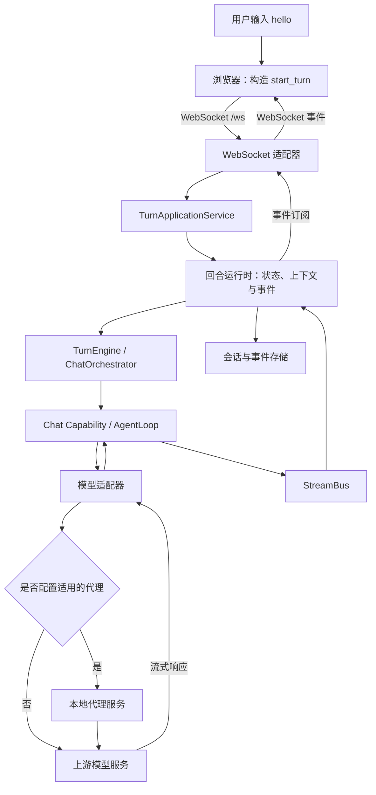
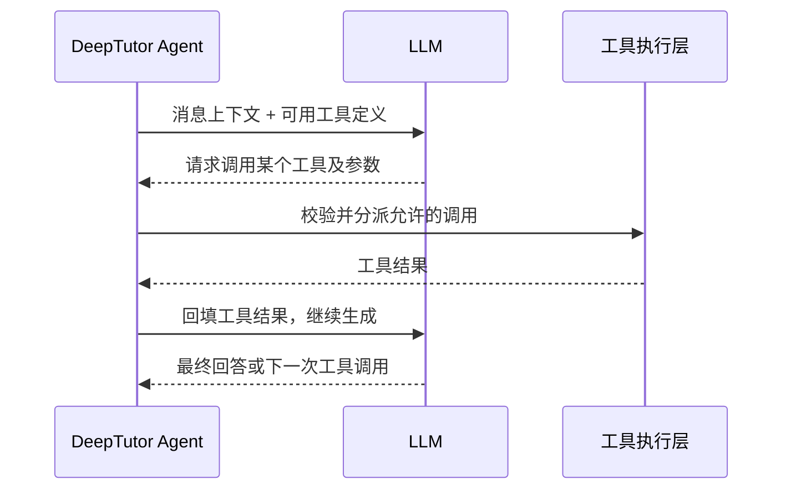
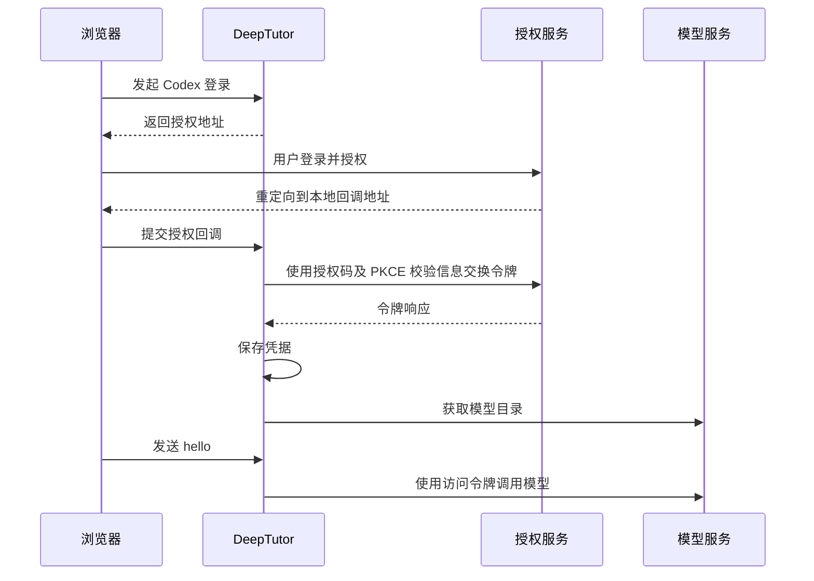

# DeepTutor 对话请求与 LLM 转接原理

本文以在 Web 页面发送 `hello` 为例，说明 DeepTutor 在用户与模型之间执行的操作，包括请求封装、回合管理、上下文组装、模型适配、认证、代理和流式响应。

说明基于当前仓库实现，重点介绍普通 `chat` 能力及 Codex OAuth 路径。示例 JSON 是便于阅读的简化结构，不是某次真实请求的完整抓包；具体内容由模型选择、会话历史、资源引用和功能设置决定。

安装与代理配置步骤见 [本地运行指南](./RUNNING_LOCALLY.md)。

回合生命周期、状态转换约束和恢复机制见 [状态建模与流转分析](./STATE_MODELING.md)。

## 1. 核心结论

DeepTutor 是有状态的 Agent 应用：浏览器将学习请求提交给后端，后端组织模型输入、管理工具执行，并将输出转换成页面可消费的事件。

输入 `hello` 时，项目通常会做以下工作：

1. 将文本、会话、工作区和模型选择等信息包装成回合请求。
2. 接收并校验请求，建立回合记录，协调执行和订阅。
3. 解析当前模型，准备系统提示词、历史消息和按需加载的学习上下文。
4. 选择 `chat` 能力，挂载当前允许使用的工具。
5. 由模型适配器转换协议、附加认证信息并发送请求。
6. 处理模型输出；如有工具调用，执行工具后继续请求模型。
7. 持久化相关事件，通过 WebSocket 更新页面并汇总用量。

这里的“转接”主要是应用层协议和数据转换，没有一个通用的“转接操作码”。`start_turn` 是 DeepTutor 的 WebSocket 命令类型，不是发给 LLM 的提示词或机器指令。

## 2. 总体链路



浏览器与 DeepTutor 之间使用 WebSocket；模型侧的协议取决于供应商。本文的 Codex 路径使用 HTTPS POST 和 SSE 流式响应，两个连接不是同一条连接。

## 3. 前端：把输入封装成回合请求

前端首先检查输入是否为空，再将消息与当前页面配置一起提交。简化示例：

```json
{
  "type": "start_turn",
  "content": "hello",
  "capability": "chat",
  "session_id": "当前会话ID",
  "client_submission_id": "本次提交ID",
  "llm_selection": null,
  "knowledge_bases": [],
  "attachments": []
}
```

| 字段 | 作用 |
| --- | --- |
| `content` | 用户本次输入 |
| `capability` | 当前执行能力，例如 `chat`、`deep_solve` |
| `session_id` | 将本次请求关联到会话及历史分支 |
| `client_submission_id` | 标识一次提交，支持重复提交识别 |
| `llm_selection` | 显式模型选择；为空时后端解析默认配置 |
| `workspace_id` | 若携带，用于指定工作区范围 |
| `knowledge_bases`、`attachments` | 本次选择的知识库和附件 |
| 其他资源引用 | 笔记、阅读材料、记忆、技能、MCP、角色等 |

这些字段是 DeepTutor 的业务协议。会话 ID、提交 ID 等不会因为出现在此请求中就自动成为模型可见内容；后端还会组装专门的模型请求。

源码：[请求组装](../web/features/chat/controllers/buildStartTurnInput.ts)、[前端传输客户端](../web/features/chat/transport/TurnRuntimeClient.ts)。

## 4. 后端：接收、持久化和协调回合

[WebSocket 适配器](../deeptutor/api/routers/unified_ws.py)解析 JSON 命令并校验协议，将回合请求交给 [TurnApplicationService](../deeptutor/app/service.py)，然后订阅该回合的事件。

应用服务及回合运行时负责：

- 管理提交、会话、回合及其执行状态。
- 处理用户和工作区作用域，准备能力执行所需的数据。
- 协调执行归属、取消、重试与订阅。
- 保存用于历史展示及重连回放的事件。

这意味着浏览器断开连接和后端执行终止是两个不同事件。重连时可以恢复事件展示，但事件回放不代表工作进程崩溃后能从任意模型调用或工具步骤自动继续执行。

主要实现：[回合运行时](../deeptutor/services/session/turn_runtime.py)、[执行器](../deeptutor/services/session/turns/executor.py)。

## 5. 上下文：模型看到的通常不只有 hello

执行器会先解析当前模型配置，再准备会话历史、学习上下文及其他资源。Chat 流程进一步构造模型消息。

模型输入可概括为：

```text
系统提示词：学习助手行为、语言、运行规则、工具使用说明等
历史消息：当前会话分支中纳入上下文的对话
上下文快照：本回合需要补充或更新的资源、状态等
当前用户消息：hello
工具定义：本回合允许模型请求调用的工具
```

| 输入来源 | 是否无条件加入 |
| --- | --- |
| 当前用户文本 | 正常聊天请求会加入 |
| 系统提示词 | 由所选能力及配置构建 |
| 会话历史 | 根据会话分支与上下文预算整理 |
| 角色、语言和学习信息 | 根据用户配置及适用场景加入 |
| 记忆、附件、笔记和阅读材料 | 根据引用、设置、权限及上下文规则加入 |
| 知识库内容 | 选择知识库不等于把整个知识库发送给模型；检索内容按流程进入上下文 |
| 工具定义 | 根据能力、开关和上下文门控挂载 |

部分上下文以系统提示词加入，部分会作为带标记的消息快照加入；不能把所有额外信息都简单理解为一个固定 system prompt。

长会话可能触发历史整理或压缩，因此页面上能看到的全部历史不一定原样出现在每次模型请求中。上下文整理也可能带来额外模型调用，实际取决于状态和配置。

源码：[消息组装](../deeptutor/agents/loop/pipeline.py)、[提示词块](../deeptutor/agents/loop/prompt_blocks.py)、[历史上下文构建](../deeptutor/services/session/context_builder.py)。

## 6. Agent：一次发送可能对应多次模型调用

普通聊天进入 [ChatCapability](../deeptutor/agents/chat/capability.py)，再由共享 Agent 循环执行。

如果模型直接回复问候语，通常无需执行工具。如果它返回工具调用，流程如下：



工具由 DeepTutor 执行，模型输出的是调用请求。用户可切换的工具、上下文门控工具和能力专属工具有不同的挂载规则，不能把“模型知道工具名字”视为“模型拥有所有执行权限”。

一个 UI 回合可以包含多次模型请求。`hello` 通常可以直接回答，但仅凭输入文本不能保证实际调用次数。

源码：[Agent 循环](../deeptutor/agents/loop/agent_loop.py)、[工具组合规则](../deeptutor/agents/_shared/tool_composition.py)。

## 7. 模型适配：转换成供应商接受的协议

不同供应商的认证方法、输入结构、工具格式与流式事件存在差异。适配器把内部表示转换成所选供应商的请求，并将返回值转换成统一的回答和工具调用对象。

### 7.1 Codex OAuth 路径

当前 [Codex 适配器](../deeptutor/services/llm/provider_core/openai_codex_provider.py)直接使用 HTTP 客户端调用仓库配置的兼容接口：

```text
https://chatgpt.com/backend-api/codex/responses
```

此地址属于当前项目的兼容实现，后续可能随上游变化而调整，不应当作永久稳定的公共 API 承诺。

该路径不会启动 Codex CLI，也不会自动读取或修改 Codex CLI 的登录状态。DeepTutor 使用自己的 OAuth 服务取得并管理令牌。

### 7.2 请求体转换

核心映射如下：

| 内部信息 | Codex 请求字段 |
| --- | --- |
| 转换后得到的系统提示词 | `instructions` |
| 用户、助手及工具历史 | `input` 中的消息、函数调用和结果项 |
| 可用工具定义 | `tools`，有工具时携带 |
| 选中的模型名 | `model`，去除内部 Codex 前缀 |
| 推理强度 | `reasoning.effort`，设置后携带 |
| 流式输出 | `stream: true` |
| 服务端存储选项 | `store: false` |

仅保留一条用户消息时，简化请求示例如下：

```json
{
  "model": "所选模型标识",
  "instructions": "DeepTutor 组装后的系统提示词",
  "input": [
    {
      "role": "user",
      "content": [{"type": "input_text", "text": "hello"}]
    }
  ],
  "stream": true,
  "store": false,
  "tool_choice": "auto"
}
```

实际实现还会设置输出详细程度、缓存路由键和其他兼容字段。`store: false` 是上游请求参数，不会关闭 DeepTutor 自己的本地会话记录，也不能单独据此推断上游的全部数据保留策略。

源码：[消息与工具转换](../deeptutor/services/llm/provider_core/openai_responses/converters.py)。

### 7.3 请求头与认证

后端会添加 `Authorization: Bearer <访问令牌>`；存在账户 ID 时，还会添加 `chatgpt-account-id`。同时携带 JSON 内容类型、SSE 接收类型及客户端标识。

认证信息由后端使用，不是用户需要写进聊天框的内容。访问令牌刷新、模型访问校验和认证失败处理发生在服务及适配器层。

## 8. OAuth 登录与聊天请求是两条流程

OAuth 登录用于让 DeepTutor 获得访问模型所需的凭据；发送 `hello` 则使用已经获得的凭据进行推理。



推理主机与令牌交换主机并不相同，二者都需要后端具备相应的网络访问能力。

浏览器显示“回调已收到”只代表回调阶段完成，不代表令牌交换、模型目录获取和推理都已成功。

源码：[OAuth 请求与回调](../deeptutor/services/codex_auth/oauth.py)、[认证生命周期](../deeptutor/services/codex_auth/service.py)、[模型目录](../deeptutor/services/codex_auth/catalog.py)。

## 9. 本地代理负责什么

设置 `codex_proxy_url` 后，Codex 后端外发请求通过指定 HTTP、HTTPS 或 SOCKS5 代理发送：

```text
DeepTutor 后端 → 本地代理 → Codex 授权或模型服务
```

代理覆盖授权码交换、令牌刷新与撤销、模型列表、客户端版本查询和 Codex 对话请求。它不会参与提示词构建、历史整理或工具选择。

以下网络路径仍保持各自行为：

- 浏览器访问授权页面：使用浏览器自己的网络配置。
- 浏览器与 DeepTutor 的 WebSocket：使用应用连接地址。
- 本地 OAuth 回调监听：直接监听回环地址。
- 非 Codex 供应商请求：不使用本次新增的 Codex 专用设置。

设置留空时不向 HTTPX 传入显式代理，保留其原有环境代理行为。显式代理不可达时请求失败，不会自动降级为直连。配置代理本身不会关闭 TLS 校验，也不能保证账号、地区或模型访问权限满足上游要求。

源码：[代理选项](../deeptutor/services/codex_auth/network.py)、[地址校验](../deeptutor/services/config/network_proxy.py)。

## 10. 返回链路：SSE 转为页面事件

Codex 返回的 SSE 流由适配器解析为文本增量、工具调用和结束状态。Agent 与能力层将这些结果转换为 DeepTutor 的内部事件，由回合运行时发布并持久化，再通过 WebSocket 传回浏览器。

页面根据事件逐步显示回答、工具执行过程和完成状态。回合最终结果使用统一结果封装，相关用量由项目的统计机制汇总。

因此，页面上的逐字显示不是浏览器直接读取上游 SSE，而是后端解析、处理后推送的流式事件。

源码：[事件总线](../deeptutor/runtime/stream_bus.py)、[事件协议](../deeptutor/core/stream.py)、[统一结果封装](../deeptutor/agents/_shared/capability_result.py)。

## 11. 故障定位与此前 hello 的实际情况

| 现象 | 失败层级 | 应优先检查 |
| --- | --- | --- |
| 无法连接服务器、消息未发出 | 浏览器到 DeepTutor | 服务状态、WebSocket、前端 API 转发地址 |
| `No active LLM model is configured` | 模型配置解析 | 是否添加模型、设置默认模型并应用更改 |
| OAuth 回调超时 | 授权回调 | 回调端口、远程部署的回调访问路径 |
| `token_exchange_failed` | 授权码换令牌 | 后端到授权服务器的连通性及具体拒绝原因 |
| 模型目录获取失败 | 登录后的目录查询 | 模型服务连通性、登录状态和账户权限 |
| 推理返回 401、403、429 | 模型服务 | 登录有效性、访问权限、配额或速率限制 |
| 工具执行失败 | Agent 工具层 | 工具配置、权限、依赖及执行结果 |

本会话此前定位到的两次问题应分开理解：

1. 最早发送 `hello` 时，后端日志显示没有活动模型，执行在解析模型配置处失败。该次请求尚未进入实际 LLM 推理。
2. 随后 Codex 登录状态报告 `token_exchange_failed`。额外的不含凭据诊断请求收到 HTTP 403，错误码为 `unsupported_country_region_territory`，说明当时后端网络出口受到地区访问限制。这是认证链路诊断，不是模型对 `hello` 的回答。

以上记录反映当时的排查结果，不代表当前或未来网络状态。要确认某一次成功对话究竟发出了多少请求、携带哪些内容，应关联该次 `session_id`、`turn_id` 和执行事件进行专门诊断；本文没有记录真实令牌、密钥或完整模型请求体。

## 12. 源码索引

| 环节 | 主要入口 |
| --- | --- |
| 前端请求构造 | [buildStartTurnInput.ts](../web/features/chat/controllers/buildStartTurnInput.ts) |
| 前端 WebSocket 传输 | [TurnRuntimeClient.ts](../web/features/chat/transport/TurnRuntimeClient.ts) |
| 后端 WebSocket 路由 | [unified_ws.py](../deeptutor/api/routers/unified_ws.py) |
| 回合应用服务 | [service.py](../deeptutor/app/service.py) |
| 执行引擎 | [turn_engine.py](../deeptutor/runtime/turn_engine.py) |
| 能力路由 | [orchestrator.py](../deeptutor/runtime/orchestrator.py) |
| 上下文与回合执行 | [executor.py](../deeptutor/services/session/turns/executor.py) |
| Agent 循环 | [agent_loop.py](../deeptutor/agents/loop/agent_loop.py) |
| Codex 模型适配 | [openai_codex_provider.py](../deeptutor/services/llm/provider_core/openai_codex_provider.py) |
| Codex OAuth 服务 | [service.py](../deeptutor/services/codex_auth/service.py) |
| 网络设置页面 | [NetworkSettingsSection.tsx](../web/features/settings/sections/NetworkSettingsSection.tsx) |
