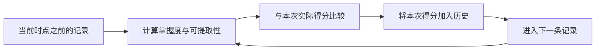

# 学习预测离线评测

本工具检验当前掌握度分数和复习模型能否预测**下一次已记录的测验结果**。它提供可重复的数据回放、延迟复测分组、校准指标和基线比较，帮助判断后续算法修改是否有证据支持。

评测入口为 `python -m deeptutor.learning.eval`。工具读取你明确指定的 JSON/JSONL 文件，不读取应用数据库、不请求 LLM、不上传数据、不改变生产算法或已有学习记录。只有显式使用 `--save` 时才创建报告文件。

**预测更准不等于教学更有效。** 验证某种教学或复习策略能否改善长期学习，还需要合适的对照实验和真实用户数据。仓库示例全部是人工构造的 `synthetic` 数据，不能用来宣称产品效果。

相关文档：[运行指南](./RUNNING_LOCALLY.md)、[状态建模](./STATE_MODELING.md)。

## 1. 快速运行

在项目根目录执行（Windows PowerShell）：

```powershell
.\.venv\Scripts\python.exe -m deeptutor.learning.eval `
  deeptutor/learning/eval/fixtures/synthetic_attempts.json
```

使用已激活的 Python 环境时：

```bash
python -m deeptutor.learning.eval deeptutor/learning/eval/fixtures/synthetic_attempts.json
```

保存详细 JSON 报告：

```powershell
.\.venv\Scripts\python.exe -m deeptutor.learning.eval `
  deeptutor/learning/eval/fixtures/synthetic_attempts.json `
  --minimum-history 1 --delayed-days 1 --bins 10 `
  --save learning-eval-report.json
```

`--save` 的目标父目录必须已经存在，目标文件必须尚不存在；不会覆盖输入或旧报告。报告包含匿名标识和逐次测验得分，仍应按学习记录管理。请勿将真实用户数据或报告提交到公共仓库。

| 参数 | 默认值 | 说明 |
| --- | --- | --- |
| `dataset` | 必填 | `.json`、`.jsonl` 或 `.ndjson` 文件 |
| `--minimum-history` | `1` | 每个学习者/知识点至少观察几次后才开始评分，必须为正整数 |
| `--delayed-days` | `1.0` | 与上一条已记录测验相隔多少天才计入延迟复测，必须为有限正数 |
| `--bins` | `10` | 等宽校准分桶数量，范围 1–100 |
| `--format` | `text` | `text` 为摘要；`json` 将完整报告输出到标准输出 |
| `--save` | 不保存 | 将完整 JSON 报告写入一个新文件 |

## 2. 输入数据规范

JSON 对象示例：

```json
{
  "schema_version": 1,
  "name": "synthetic-two-attempts",
  "provenance": "synthetic",
  "attempts": [
    {
      "id": "attempt-001",
      "learner_id": "anonymous-a",
      "knowledge_point_id": "course-a/fractions",
      "knowledge_type": "concept",
      "timestamp": 1700000000,
      "outcome": 1
    },
    {
      "id": "attempt-002",
      "learner_id": "anonymous-a",
      "knowledge_point_id": "course-a/fractions",
      "knowledge_type": "concept",
      "timestamp": 1700172800,
      "outcome": 0
    }
  ]
}
```

| 字段 | 含义与限制 |
| --- | --- |
| `schema_version` | 数据格式版本，当前只接受 `1` |
| `name` | 数据集名称 |
| `provenance` | `synthetic`（人工构造）、`observed`（真实观察）或 `unspecified`（未声明） |
| `attempts` | 非空记录列表 |
| `id` | 全文件唯一、非空的测验记录 ID |
| `learner_id` | 稳定匿名学习者 ID；同一学习者必须保持一致，不要使用姓名或邮箱 |
| `knowledge_point_id` | 稳定知识点 ID，跨课程有冲突时应加课程前缀 |
| `knowledge_type` | `memory`、`concept`、`procedure` 或 `design` |
| `outcome` | 该次测验的实际归一化成绩，数值范围 `[0, 1]`；正确为 `1`，错误为 `0`，也支持部分得分 |
| `timestamp` | 可选，非负、有限的 Unix **秒**时间戳；不是毫秒，也不是日期字符串 |
| `review_quality` | 可选，`[0, 1]` 的有效学习证据强度；缺省时使用 `outcome`，只参与后续复习状态更新 |
| `assessment_type` | 可选，`quiz`（默认）、`qualitative` 或 `review`，传给生产复习调度器 |

禁止未知字段，数值字段不自动接受字符串或布尔值。JSON 也可以直接提供记录数组，此时名称和来源使用默认值。

JSONL 每行一条记录，可在第一条非空行增加元数据头：

```jsonl
{"type":"dataset","schema_version":1,"name":"synthetic-jsonl-example","provenance":"synthetic"}
{"id":"a1","learner_id":"anonymous-a","knowledge_point_id":"course-a/kp-1","knowledge_type":"memory","timestamp":1700000000,"outcome":1}
{"id":"a2","learner_id":"anonymous-a","knowledge_point_id":"course-a/kp-1","knowledge_type":"memory","timestamp":1700086400,"outcome":0}
```

允许空行和 UTF-8 BOM。JSONL 的元数据头不能嵌入 `attempts`；省略元数据头时，来源为 `unspecified`，不会自动认为这些记录来自真实用户。

## 3. 怎样避免未来数据泄漏

每个 `(learner_id, knowledge_point_id)` 是一条独立时间线：

1. 有时间戳时按时间升序排列；同一时间线的重复时间戳会被拒绝，不人为推断先后顺序。
2. 同一时间线必须全部有时间戳或全部没有时间戳；不允许混合。同一数据集中的不同时间线可以采用不同模式。
3. 每次预测只使用这个学习者在这个知识点上的**先前记录**。默认第一条仅用于初始化，不评分。
4. 先记录本次预测和与真实成绩的误差，再将本次成绩加入历史、更新复习状态。
5. 已经评过分的测验，在后续时间点成为历史。这是逐次预测再更新的在线回放评测，不是一次性的固定训练集/测试集划分。



没有时间戳时，按该时间线在文件中的顺序评估掌握度。不会生成虚构日期，也不会计算该时间线的保持率、复习期限或延迟复测指标。

评测显式使用记录时间，默认复习模型的时间单位固定为一天 86400 秒，不受 `LEARNING_DEBUG` 的生产调试压缩设置影响。同样的输入和参数会生成相同报告，不使用当前系统时间或随机数。报告附带规范化数据的 SHA-256 指纹，方便确认两次比较使用了相同输入；比较不同代码版本时还应自行记录 Git 提交号。

## 4. 评估的模型和基线

| 名称 | 预测如何生成 | 需要时间戳 |
| --- | --- | --- |
| `mastery` | 直接调用当前 `compute_mastery`，使用先前成绩列表 | 否 |
| `retention` | 调用当前 `SpacedRepetitionScheduler.retrievability`，状态只由先前证据更新 | 是 |
| `history_mean` | 同一学习者/知识点的所有先前成绩平均值 | 否 |
| `constant_0_5` | 固定预测为 `0.5`，不依赖任何标签统计 | 否 |

掌握度分数是现有规则计算的评分，并非已拟合的召回概率。本工具将它作为“下一次预期成绩”接受检验，不意味着更改其生产语义。复习模型还是现有指数遗忘基线，不会拟合新的参数。

每个候选模型和基线**在相同的可评分记录上**比较。例如 `retention` 不包含无时间戳记录，相应基线比较也会剔除这些记录；不能直接拿两种不同样本集的汇总分数判断谁更好。

`review_quality` 只影响看到本次结果之后的复习状态，不改变本次目标得分和掌握度历史。它适合表达提示辅助等使学习证据弱于表面成绩的情况；只有导出方能够可靠确定时才填入。

## 5. 报告怎样解读

### 分组

- `cohorts.all`：达到最小历史条数的所有记录。
- `cohorts.delayed`：有时间戳，且与同一时间线的上一条记录至少间隔 `--delayed-days` 天的记录。
- `by_knowledge_type`：按记忆、概念、程序、设计类型分别统计。
- `predictions`：逐条预测，保留历史条数、与前次测验的间隔、更新前的复习期限，以及各模型分数。

“延迟”只说明与**上一条记录**的时间间隔；如果期间发生过未记录的学习，不能据此判断是完全没有练习后的记忆保持。复习期限为更新前已有的计划时间，工具不据此安排或修改真实复习任务。

### 指标

| 指标 | 定义 | 如何比较 |
| --- | --- | --- |
| `count` | 当前模型和分组实际评分记录数 | 先看样本量与覆盖范围 |
| `mean_squared_error` | `mean((prediction - outcome)^2)` | 越低越好，对大误差更敏感 |
| `mean_absolute_error` | `mean(abs(prediction - outcome))` | 越低越好，反映平均成绩偏差 |
| `brier_score` | 只在 `outcome=0/1` 的记录上计算均方误差 | 越低越好；二元样本量见 `brier_count` |
| `expected_calibration_error` | 按预测值分桶后，各桶预测均值与实际均值差的样本量加权平均 | 越低表示整体校准差距越小，需同时检查分桶样本量 |
| `calibration_bins` | 各等宽桶的上下界、样本量、平均预测、平均成绩和绝对差 | 前闭后开，最后一桶包含预测值 `1` |
| `baseline_comparisons.*.error_delta` | 候选模型误差减去同样本基线误差 | 负值表示候选模型误差更低 |

部分得分可以进入 MSE、MAE 和校准分桶；此时校准针对预期归一化成绩，不能解读为二元回忆成功率。Brier 只包含二元目标，所以其分母可能小于 `count`。没有可用样本的指标为 `null`，命令行显示 `n/a`，不会把“没有证据”误写为零误差。

当前汇总按测验次数加权，练习频繁的用户权重更大。报告不输出显著性结论或置信区间；样本量小、分桶稀疏时，单次分数变化不足以证明效果提升。

## 6. 准备真实评测数据

工具不会自动导出或上传应用数据。真实评测需准备经过授权和匿名化的数据集，并声明 `provenance: observed`。建议：

1. 保留稳定的学习者/课程知识点标识、有效测验成绩和明确的时间单位。
2. 导出时排除撤销、无效题目、重复事件，以及不应被当作独立测验的记录；本输入格式不是应用数据库的直接快照。
3. 区分独立作答和提示辅助作答，避免把辅助答案当作无辅助召回的真实标签；需要时预先形成不同评测集。
4. 时间戳应表示当时已能获得该结果的时刻。若事后评分或跨系统延迟入库，应考虑结果可用时间，避免把当时不可见的信息提前用于预测。
5. 知识点发生拆分、合并或课程含义变化时，使用新的稳定标识，避免把不同目标当作一条时间线。
6. 使用独立的开发集选择参数，再在事先保留的用户或后续时段上验证。不要反复根据同一份最终评测集调参后将其当作泛化证据。

真实长期效果还受题目难度、提示、选择性练习、缺失记录、评分可靠性等因素影响。该工具为算法改进建立可复现的预测证据，不替代教学实验、评分一致性评估或检索引用准确性评估。

## 7. 实现与验证入口

- [输入模型与文件加载](../deeptutor/learning/eval/dataset.py)
- [按时间回放与报告](../deeptutor/learning/eval/runner.py)
- [指标计算](../deeptutor/learning/eval/metrics.py)
- [独立命令行入口](../deeptutor/learning/eval/__main__.py)
- [人工构造的示例数据](../deeptutor/learning/eval/fixtures/synthetic_attempts.json)
- [回归测试](../deeptutor/learning/tests/test_offline_eval.py)
- [生产掌握度策略](../deeptutor/learning/mastery.py)
- [生产复习调度器](../deeptutor/learning/scheduler.py)

运行测试：

```powershell
.\.venv\Scripts\python.exe -m pytest deeptutor/learning/tests/test_offline_eval.py -q
```

测试覆盖预测先于状态更新、跨用户/知识点隔离、真实时间回放、无时间戳降级、基线同样本比较、空分组、部分得分、输入校验，以及报告不覆盖原数据。
