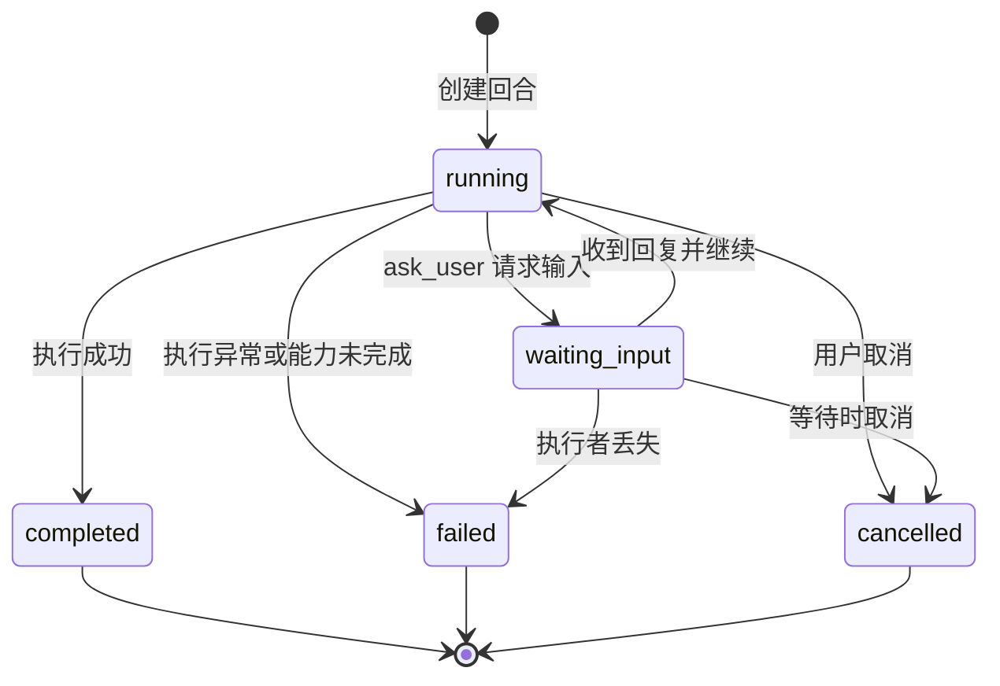
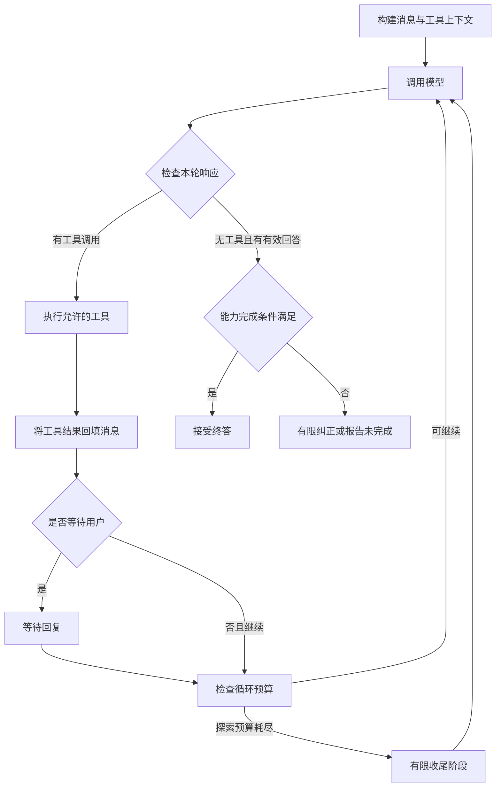

# DeepTutor 状态建模与流转分析

本文分析当前源码中的状态定义、流转控制、持久化和故障恢复，覆盖对话回合、Agent 执行、能力阶段、事件协议、前端展示与学习业务。分析日期为 2026-10-29。

本文是源码静态分析，不是并发压力测试或故障注入报告。文中“改进建议”尚未实现；状态图展示主要业务路径，不表示存储层已经实现了与图完全对应的统一转换表。

相关文档：[对话请求与 LLM 转接原理](./CHAT_REQUEST_FLOW.md)、[本地运行指南](./RUNNING_LOCALLY.md)。

## 1. 总体判断

DeepTutor 使用多层状态协作：

- **回合生命周期**表达一次执行是否活动、等待、成功、失败或取消。
- **运行时状态**保存任务、队列、租约、事件缓冲和订阅者。
- **Agent 状态**控制模型调用、工具执行、交互暂停和预算收尾。
- **能力阶段**表达业务流程进度。
- **事件协议与前端状态**协调实时显示、重连、去重和回放。
- **学习业务状态**记录跨多个聊天回合存在的学习进度及答题事务。

它已经具备可取消、可重试、可回放的 Agent 运行机制；状态转换规则仍主要分布在应用服务、执行器、存储和前端条件分支中，尚未统一为通用的工作流状态机。

| 层次 | 状态主体 | 主要载体 | 生命周期 |
| --- | --- | --- | --- |
| 回合 | 一次用户请求的执行 | `TurnStatus`、回合表 | 可持久化 |
| 运行时 | 当前执行实例 | `_TurnExecution`、任务、队列、租约 | 主要在进程内，部分协调信息在外部存储 |
| Agent | 当前回合中的模型与工具循环 | `AgentLoopState`、消息列表、调用结果 | 当前执行期间 |
| 能力 | 能力内的阶段及输出 | `CapabilityManifest`、阶段事件、结果 | 能力执行期间 |
| 前端 | 连接、提交与页面投影 | 连接状态、消息状态、事件游标 | 页面及其恢复机制 |
| 学习业务 | 学习路径、题目交互 | `LearningStage`、`InteractionStatus` 等 | 跨回合持久化 |

不同层不能互相替代。例如，连接已断开不等于回合失败，回合完成也不等于课程已学完。

## 2. 回合是技术生命周期的核心主体

一个会话包含多个回合。每次发送消息会创建或关联一个回合，回合有自己的标识、执行状态和事件序列。

[TurnStatus 定义](../deeptutor/runtime/coordination/types.py)包含六个值：

| 状态 | 含义 | 分类 |
| --- | --- | --- |
| `queued` | 已定义的排队状态 | 活动状态 |
| `running` | 正在执行 | 活动状态 |
| `waiting_input` | 等待用户回答 | 活动状态 |
| `completed` | 回合成功结束 | 终态 |
| `failed` | 回合失败 | 终态 |
| `cancelled` | 回合被取消 | 终态 |

当前普通回合的创建路径直接插入 `running`。`queued` 参与状态集合、协议和恢复判断，但源码检查未发现普通生产回合先写入 `queued` 的主路径。不能据此枚举推断存在持久化排队执行机制。

### 2.1 主要状态图



图中取消等待是逻辑路径。实现中的等待清理可能先尝试将状态恢复为 `running`，再由外层写入终态。终态写入保护也接受 `waiting_input`，防止取消与清理竞争时留下无人执行的活动回合。

源码：[回合创建与存储](../deeptutor/services/session/sqlite_store.py)、[用户输入等待](../deeptutor/services/session/turns/executor.py)、[终态与取消处理](../deeptutor/services/session/turns/lifecycle.py)。

### 2.2 持久化字段表达了哪些约束

回合表除了 `status`，还包含以下信息：

| 字段 | 建模作用 |
| --- | --- |
| `id`、`session_id` | 回合身份与所属会话 |
| `capability` | 本次执行的能力 |
| `owner_id` | 执行拥有者 |
| `fencing_token` | 执行所有权凭证，阻止持有旧凭证的执行者写入 |
| `state_version` | 状态写入版本计数 |
| `failure_code`、`error` | 结构化失败分类及错误信息 |
| `retryable` | 是否允许重试 |
| 创建、更新与完成时间 | 支持生命周期查询和诊断 |
| `assistant_message_id` | 关联生成的助手消息 |

活动状态集合还用于防止同一会话同时拥有多个活动回合。SQLite 的创建路径使用事务和活动回合唯一约束处理并发竞争。

### 2.3 状态更新是带条件的写入

`transition_turn` 在写入前检查：

1. 目标状态属于允许的状态集合。
2. 若提供 `expected_status`，当前状态必须匹配。
3. 若提供 `fencing_token`，必须与当前持久化凭证匹配。
4. 当前已是终态时，不能转到其他状态。

这些检查可以防止部分取消、完成和执行者替换竞争。例如，旧执行者不能使用失效的凭证覆盖新执行者状态。

两个边界需要准确理解：

- 这不是完整的合法转换边表。上层仍负责决定何时可以请求某次转换，部分检查参数也允许省略。
- 终态不是记录完全不可修改。同一终态仍允许重复写入，更新时间和版本计数可能变化；禁止的是终态跳到另一状态。

`state_version` 当前承担版本计数，不应单独等同于基于预期版本的完整乐观锁。

## 3. 运行时状态与持久化状态分开

[_TurnExecution](../deeptutor/services/session/_turn_runtime_shared.py)保存当前进程需要的执行对象，包括：

```text
task                    执行协程
awaiting_user_reply     是否正在等待用户
subscribers             当前订阅者
events / next_seq       事件缓冲与序号
flush_lock / flush_task 事件落盘协调
lease                   当前执行租约
lease_lost              是否丢失执行所有权
shutdown_requested      是否正在关闭
```

这些对象不是回合表中 `status` 的简单副本。一个 `running` 回合内部可以处于等待模型、执行工具、持久化输出等不同阶段。

`ask_user` 使用进程内 `asyncio.Queue` 等待回复。数据库记录 `waiting_input` 有助于查询和恢复判定，但不能凭此重新构造一个已丢失的 Python 执行栈。

多 worker 模式通过协调器和租约约束执行归属。租约续期失败或协调失效时，当前任务会停止，避免在不能证明拥有权时继续执行。后续恢复逻辑负责处理持久化状态。

源码：[协调值对象](../deeptutor/runtime/coordination/types.py)、[租约与生命周期管理](../deeptutor/services/session/turns/lifecycle.py)。

## 4. Agent 使用计数器和条件分支控制循环

[AgentLoopState](../deeptutor/agents/loop/agent_loop.py)没有定义一个覆盖全部阶段的 `agent_state` 枚举，主要保存：

| 字段 | 含义 |
| --- | --- |
| `rounds` | 模型调用轮数 |
| `exploration_rounds` | 探索轮数 |
| `settlement_rounds` | 收尾轮数 |
| `tool_steps` | 工具执行批次 |
| `reasoning_budget_recoveries` | 推理预算恢复次数 |
| `sources` | 已收集来源 |

模型响应、工具分派结果和能力检查共同触发下一步：



这张图省略了截断续写、工具直接终止、能力输出替换和异常分支。

控制规则包括：

- 有工具调用时，模型消息及工具结果进入下一轮上下文。
- 无工具调用不自动等于完成，还要处理空输出、截断和能力完成条件。
- 探索轮次耗尽后进入有上限的收尾阶段；普通路径最终禁用工具，要求基于已有信息收尾。
- 交互工具可以暂停，终止工具可以直接结束。
- 部分中途异常可以基于已有材料收尾；首轮失败或已经输出部分内容后的特定传输错误会直接传播。

因此，LLM 决定“接下来需要什么”，Python 代码决定“这个动作是否允许、能否继续、能否结束”。

## 5. Capability 阶段是进度协议，不是自动执行的状态图

[CapabilityManifest](../deeptutor/core/capability_protocol.py)可以声明阶段，例如研究能力中的分解、研究、报告。但阶段列表本身不强制验证转换顺序，也不会自动调度下一阶段。实际流程由能力实现控制。

[StreamBus.stage](../deeptutor/runtime/stream_bus.py)通过上下文管理器在代码块进入和离开时发送：

```text
stage_start → 阶段代码执行 → stage_end
```

`stage_end` 在 `finally` 中发出，所以只能说明阶段代码块已经退出，不能单独证明阶段成功。

### 5.1 四种“完成”不能混用

| 信号 | 实际语义 |
| --- | --- |
| 模型结束当前输出 | 本次模型请求停止输出 |
| `stage_end` | 当前阶段代码块结束 |
| 能力结果声明 `completed=true/false` | 能力对业务完成情况的声明 |
| 回合终态 / `done` | 外层执行生命周期及事件流结束 |

当前编排器会检查能力结果。若能力正常返回但明确声明 `completed=false`，则回合被判为 `failed`，并附加 `capability_incomplete` 等信息。

旧能力如果未声明完成字段，仍保留兼容处理。因此不能将当前实现描述为所有能力均强制返回严格的完成类型。

源码：[编排器](../deeptutor/runtime/orchestrator.py)、[结果完成性读取](../deeptutor/runtime/stream_bus.py)。

## 6. 事件日志连接执行过程与页面投影

[StreamEvent](../deeptutor/core/stream.py)包含：

```text
type + source + stage + content + metadata
session_id + turn_id + seq + timestamp
```

其中 `turn_id` 标识事件所属执行，`seq` 标识回合内顺序；数据库对 `(turn_id, seq)` 设置唯一约束。

| 事件类型 | 作用 |
| --- | --- |
| `content` | 回答内容增量 |
| `tool_call / tool_result` | 工具执行请求和结果 |
| `progress` | 进度及相关元数据 |
| `wait_for_input` | 用户交互请求 |
| `result` | 能力产出结果 |
| `error` | 错误信息，是否终止取决于元数据 |
| `done` | 回合流结束，状态在元数据中 |

终态错误会携带 `turn_terminal`，外层据此解析失败状态。不能把每个工具错误都直接升级为整个回合失败。

事件会实时发布并按批次、周期和结束条件持久化。结束刷新用于减少“页面已结束但事件尚未保存”的窗口；不同协调模式仍有各自的传递与恢复路径。

项目同时直接更新状态记录并保存事件，因此它是**状态记录与可回放日志并存**的设计。它不是完全依靠重放事件重建全部业务状态的纯事件溯源系统。

源码：[事件发布与刷新](../deeptutor/services/session/turns/lifecycle.py)、[回合结果解析](../deeptutor/services/session/_turn_runtime_shared.py)、[SQLite 事件存储](../deeptutor/services/session/sqlite_store.py)。

## 7. 前端分别建模连接、回合和提交状态

### 7.1 连接状态

[TurnRuntimeClient](../web/features/chat/transport/TurnRuntimeClient.ts)定义：

```text
idle / connecting / connected / recovering / stopped
```

它表达连接是否可用，不表示后端执行是否完成。断线后可以进入恢复，携带 `after_seq` 请求续传，按序号去重、缓冲缺口并补播。

### 7.2 回合展示和乐观消息

[ChatStateAdapter](../web/features/chat/ChatStateAdapter.tsx)还维护展示状态：

```text
idle / running / completed / failed / cancelled / rejected
```

并独立保存 `isStreaming`、当前阶段、活动回合和最后事件序号。用户发送后可以先出现临时消息行，后续根据服务端确认信息替换为持久化消息身份。

这些状态支持区分：

| 情况 | 页面应表达的事实 |
| --- | --- |
| 请求尚未被后端接收 | 消息未发送或提交被拒绝 |
| 后端接收后执行失败 | 回合失败 |
| WebSocket 断开，后端仍运行 | 连接恢复中 |
| 后端已结束，最后事件暂未到达 | 需要补播或状态核对 |

前端不会仅因暂时没有新内容就把回合判成终态。连接状态与回合状态分开，是处理长模型请求和断线场景的重要基础。

## 8. 重试、取消和故障恢复

### 8.1 重试不会简单复活旧回合

同一提交关联的旧回合仍活动或已经成功时，可以复用已存在的回合。旧回合已经失败或取消时，重试路径会关联原有消息信息并创建新的 `turn_id`，保留旧终态。

显式重新生成也会重建并校验请求后重新启动执行。页面可能替换原助手展示，但执行历史中仍是不同的回合。

这与连接重连不同：重连通常订阅、回放原回合，不应自动被理解为重新执行任务。

源码：[提交幂等与创建](../deeptutor/services/session/sqlite_store.py)、[重新生成请求准备](../deeptutor/services/session/turns/request_preparer.py)。

### 8.2 取消需要与终态写入协调

取消请求涉及执行任务停止、交互等待清理、输出保存和终态写入。通过等待任务清理、预期状态检查和执行凭证约束，项目减少取消与正常结束之间的覆盖竞争。

它不是把前端的停止按钮直接映射为“立即覆盖数据库状态”。尤其在等待用户时，等待标记与持久化状态都需要清理。

### 8.3 失联恢复是明确失败后允许重试

[TurnRecoveryService](../deeptutor/runtime/coordination/recovery.py)处理失去执行者的活动回合，写入终态错误和结束事件，持久化相关事件，然后设置：

```text
status = failed
failure_code = worker_lost
retryable = true
```

这能让前端不再永久显示“正在执行”，也为重新执行提供明确依据，但不会恢复丢失的模型连接、Python 协程栈或任意工具执行点。

## 9. 学习业务状态具有独立生命周期

[LearningStage](../deeptutor/learning/models.py)定义诊断、讲解、理解检查、练习、错因诊断、复习与完成等业务阶段。

同一模块中的 `InteractionStatus` 定义单次学习交互状态：

```text
registered / awaiting_input / answered / graded / abandoned
```

这些状态由学习服务和存储维护，可以跨聊天回合存在。例如：

- 一个回合已经完成，但学习路径仍处于练习阶段。
- 回合等待用户输入时，题目交互也可能处于等待回答状态，但两者是不同实体。
- 进程重启后，可以知道题目是否已回答或已评分；这不等于恢复原来挂起的聊天执行栈。

将教学事务与技术执行分开，有利于避免重试时重复评分，也使课程进度不依赖某个浏览器连接是否在线。

源码：[学习模型](../deeptutor/learning/models.py)、[学习服务](../deeptutor/learning/service.py)。

## 10. 架构评价与改进建议

### 已有优势

- 活动状态、终态和结构化失败信息有明确表示。
- 回合与会话分开，重试可保留原执行结果。
- 幂等提交、执行拥有权、状态条件写入和事件序号都有实际实现。
- 连接恢复与执行重试分开，避免断线直接导致重复执行。
- 能力完成性与函数正常返回有所区分。
- 教学业务具有独立持久状态，不完全依附聊天生命周期。

### 维护边界

- 合法转换规则分散，增加状态时需要同步应用层、存储、协议及前端。
- Agent 使用计数器、布尔标记、局部变量和结果对象组合控制，阅读成本随异常分支增加。
- 阶段列表不等于经过验证的状态机。
- 事件日志支持回放，但尚不足以重建全部执行上下文。
- 流程正常结束并不能证明教学目标真正达成或模型结论正确。

### 建议一：集中声明回合转换规则

可以将“源状态、动作、目标状态、前置条件”收敛为共享协议，减少 SQLite、PocketBase 和运行时代码之间的规则漂移。

| 动作 | 源状态示例 | 目标状态 | 条件示例 |
| --- | --- | --- | --- |
| 请求用户输入 | `running` | `waiting_input` | 执行者仍持有有效凭证 |
| 接受用户回复 | `waiting_input` | `running` | 回复属于当前有效交互 |
| 完成 | 活动状态 | `completed` | 能力完成条件成立 |
| 失败 | 活动状态 | `failed` | 有明确失败结果 |
| 取消 | 活动状态 | `cancelled` | 执行清理及终态协调完成 |

这张表是改进方向示意，不是当前已经存在的统一实现。

### 建议二：强化结构化结果类型

逐步使用明确的完成、失败、取消和交互结果类型，减少通过布尔值、异常和自由格式元数据联合推断结局。迁移时需要保留旧能力协议的兼容边界，并明确“等待是继续中的状态还是交付给外层的结果”。

### 建议三：按需引入执行检查点

若目标是深度研究或长生成任务跨进程续跑，需要持久化步骤身份、输入输出、幂等标识、待执行动作和恢复规则。

仅增加 `paused` 状态，或保留所有文本事件，都不足以获得任意步骤恢复能力。模型调用和外部工具是否可以安全重试，也需要单独定义。

## 11. 源码索引

| 主题 | 文件 |
| --- | --- |
| 回合状态、失败分类、租约 | [coordination/types.py](../deeptutor/runtime/coordination/types.py) |
| 回合应用服务 | [app/service.py](../deeptutor/app/service.py) |
| SQLite 状态、提交与事件 | [session/sqlite_store.py](../deeptutor/services/session/sqlite_store.py) |
| PocketBase 存储实现 | [session/pocketbase_store.py](../deeptutor/services/session/pocketbase_store.py) |
| 回合执行与输入等待 | [turns/executor.py](../deeptutor/services/session/turns/executor.py) |
| 取消、租约、事件刷新 | [turns/lifecycle.py](../deeptutor/services/session/turns/lifecycle.py) |
| 执行对象及终态解析 | [_turn_runtime_shared.py](../deeptutor/services/session/_turn_runtime_shared.py) |
| Agent 循环状态 | [agent_loop.py](../deeptutor/agents/loop/agent_loop.py) |
| 能力协议 | [capability_protocol.py](../deeptutor/core/capability_protocol.py) |
| 能力完成性判定 | [orchestrator.py](../deeptutor/runtime/orchestrator.py) |
| 流式事件与阶段 | [stream.py](../deeptutor/core/stream.py)、[stream_bus.py](../deeptutor/runtime/stream_bus.py) |
| 失联回合恢复 | [coordination/recovery.py](../deeptutor/runtime/coordination/recovery.py) |
| 前端连接与回放 | [TurnRuntimeClient.ts](../web/features/chat/transport/TurnRuntimeClient.ts) |
| 前端状态与消息投影 | [ChatStateAdapter.tsx](../web/features/chat/ChatStateAdapter.tsx) |
| 学习业务状态 | [learning/models.py](../deeptutor/learning/models.py) |

已有恢复场景测试可参考 [等待回合恢复测试](../tests/app/test_waiting_turn_recovery.py)和[事件日志恢复测试](../tests/runtime/coordination/test_journal_recovery.py)。本文整理过程中未重新执行这些测试。
